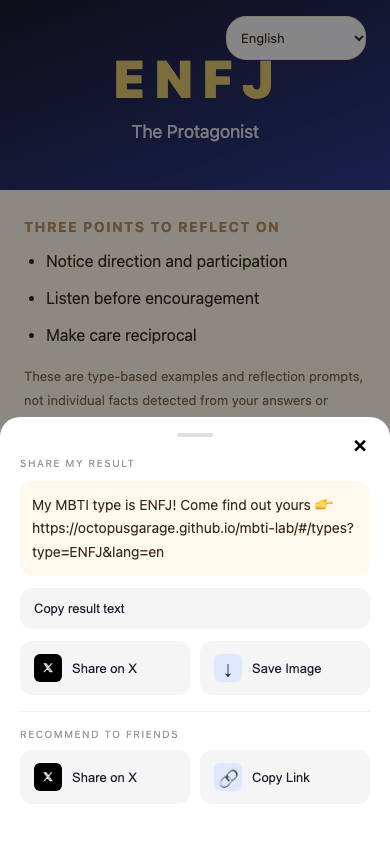

<h1 align="center">MBTI Lab</h1>

<p align="center">Personality exploration, at your own pace.</p>

<p align="center">
  60 or 93 questions · 16 detailed reports · 8 languages<br />
  Runs in your browser. No account required.
</p>

<p align="center">
  <a href="https://octopusgarage.github.io/mbti-lab/"><strong>Open the live app</strong></a> ·
  <a href="https://octopusgarage.github.io/mbti-lab/#/types">Explore the types</a> ·
  <a href="#development">Run locally</a> ·
  <a href="docs/design.md">Design notes</a>
</p>

<p align="center">
  <a href="https://github.com/OctopusGarage/mbti-lab/actions/workflows/checks.yml"></a>
  <a href="https://github.com/OctopusGarage/mbti-lab/actions/workflows/deploy.yml"></a>
</p>

## Live snapshots

[](https://octopusgarage.github.io/mbti-lab/)

| Take an assessment | Read your report | Explore the library |
| :---: | :---: | :---: |
| <a href="docs/images/assessment.png"></a> | <a href="docs/images/report.png"></a> | <a href="docs/images/types.png"></a> |

Captured from the live app on **20 October 2026**. The report is computed from a scripted demonstration assessment. [Capture provenance and refresh instructions](docs/screenshots.md).

<details>
<summary>Sharing and the original PNG export</summary>

| Share preview | Exported card |
| :---: | :---: |
| <a href="docs/images/sharing.png"></a> | <a href="docs/images/share-card.png"></a> |

The original PNG is 1080 × 1080. Its QR code opens the app; shared type links omit answers and personal proportions.

</details>

## The experience

| | |
| --- | --- |
| **Start, pause, return** | Choose 60 or 93 questions, resume a saved draft, and reopen your latest result. |
| **Read beyond four letters** | Each type has three highlights, seven expandable chapters, and three practical exercises. Dimension bars and an optional radar chart describe your answer patterns. |
| **Explore and compare** | Search all 16 types by code or localized name, follow direct links, and compare types that differ by one letter. |
| **Share with control** | Preview the caption, copy a public type link, or save a PNG card. Answers and personal proportions stay out of shared links and captions. |

**Available throughout:** English · 简体中文 · Español · Français · Deutsch · Português · 日本語 · 한국어. Language choices are remembered, translations load as needed, and public type links retain the selected language.

[Interface design and local previews →](docs/design.md)

## Data and interpretation

Scoring runs in the browser. Drafts and your latest result use browser storage when available. If storage is blocked, a warning explains the limitation and an in-memory fallback preserves the current page session. Progress may be lost after clearing browser data, changing devices, or refreshing without storage. The hosted app loads Cloudflare Web Analytics.

Reports provide editorial examples for self-reflection, rather than individual findings or predictions about ability, careers, or relationships. Percentages describe the current answers, not accuracy or ability. AI content reviews assess writing and translation quality; they do not establish scientific validity. Home-screen installation is supported in compatible browsers; offline use is not guaranteed.

## Development

Use **Node.js 24** ([.node-version](.node-version)).

```sh
npm ci
npm run dev
```

Open [localhost:5173/mbti-lab/](http://localhost:5173/mbti-lab/). For a production preview, run `npm run build` followed by `npm run preview`.

<details>
<summary>Verification commands and AI evaluation</summary>

```sh
npm test -- --run
npm run eval:check
npm run eval:questions:check
npm run build
npm run test:e2e:install
npm run test:e2e
npm audit --audit-level=high
```

The suite covers **182 unit/component/tooling tests** and **115 browser tests** across Chromium, Firefox, and WebKit, including **128 localized PNG exports** with download and QR checks. Pull requests run the verification gates; deployment from `main` waits for them to pass.

`eval:check` validates the recorded review of all 128 localized reports and its source hashes. `eval:questions:check` validates all 558 translated question pairs and their evidence. Neither command calls a model. Fresh reviews use `eval:ai` and `eval:questions` through an authenticated local Codex CLI. See [testing and evaluation](docs/testing.md) for provenance, limitations, and physical-device checks.

</details>

## Project guide

| Reference | Contents |
| --- | --- |
| [Architecture](docs/architecture.md) | Routes, scoring, persistence, and resource loading |
| [Interface design](docs/design.md) | Visual direction, interaction principles, and local previews |
| [Testing](docs/testing.md) | Browser coverage and AI evaluation evidence |
| [Screenshots](docs/screenshots.md) | Live-capture provenance and reproducible refresh workflow |
| [Maintenance](docs/maintaining.md) | Issue automation and maintainer workflows |

Built with **Vue 3**, **Vue Router**, **Vue I18n**, and **Vite**. Charts and image export use ECharts, html2canvas, and QRCode; verification uses Vitest and Playwright.

---

An [OctopusGarage](https://github.com/OctopusGarage) project. Also explore [Bracket Guess](https://github.com/OctopusGarage/bracket-guess), a bracket picker with poster export.
