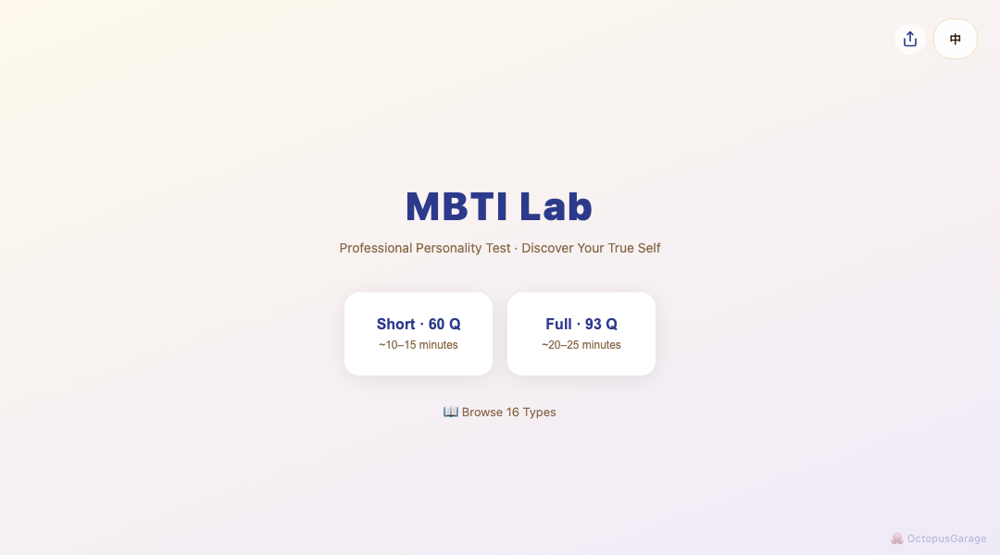
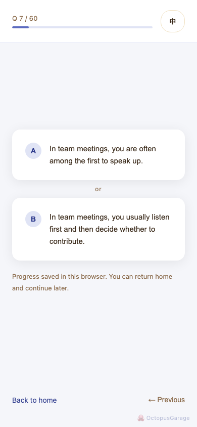
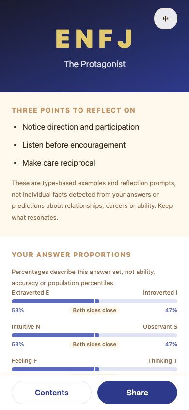
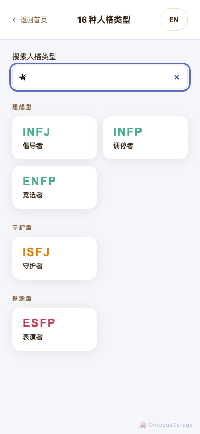
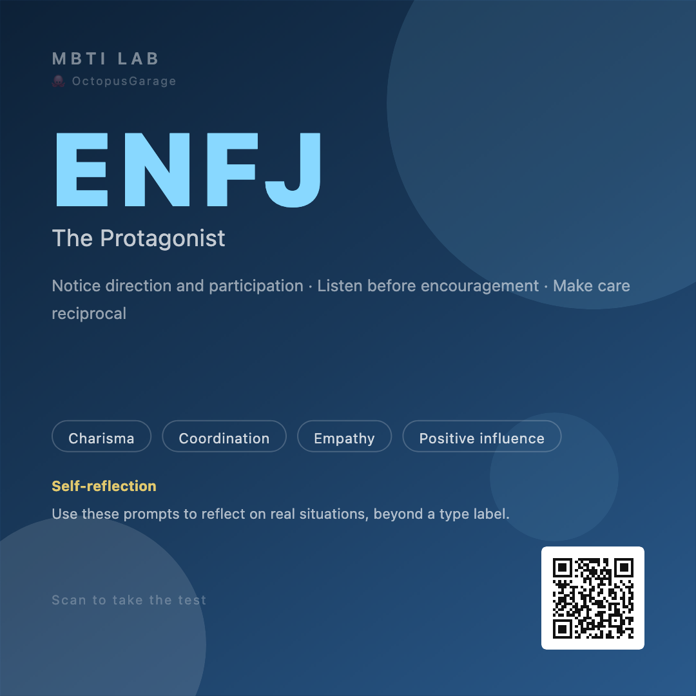

# MBTI Lab

A bilingual personality explorer with resumable assessments, detailed reports, and shareable cards.

[](https://github.com/OctopusGarage/mbti-lab/actions/workflows/checks.yml) [](https://github.com/OctopusGarage/mbti-lab/actions/workflows/deploy.yml)

[**Try the live demo →**](https://octopusgarage.github.io/mbti-lab/) · [Explore the 16 types](https://octopusgarage.github.io/mbti-lab/#/types) · [Development](#development)

Choose a 60- or 93-question assessment, explore your result in English or Chinese, and export a card to share. The experience runs in your browser, with no account required.

## Live preview

[](https://octopusgarage.github.io/mbti-lab/)

| Assessment · English | Report · English | Type search · 中文 |
| :---: | :---: | :---: |
| <a href="docs/images/assessment.png"></a> | <a href="docs/images/report.png"></a> | <a href="docs/images/types.png"></a> |

Captured from the live site on **20 October 2026**. The report and export come from a scripted demonstration assessment, not a personal result. [Capture details and refresh instructions](docs/screenshots.md).

<details>
<summary>View a share card generated by the live app</summary>

<p align="center">
  <a href="docs/images/share-card.png"></a>
</p>

The original 1080 × 1080 PNG includes a QR code back to MBTI Lab.

</details>

## What you can do

- **Pick your pace.** Choose 60 or 93 questions, return to unfinished answers, or revisit your latest result.
- **Read beyond the type code.** Each report includes three highlights, seven expandable chapters, and three practical exercises.
- **Explore all 16 types.** Search English or Chinese names, open direct type links, and compare types that differ by one letter.
- **See your answer patterns.** View dimension proportions and expand an optional radar chart for another perspective.
- **Share selectively.** Preview a caption, copy a public type link, or export a PNG. Shared links and captions exclude answers and personal proportions.
- **Use either language.** Switch between English and Chinese throughout the assessment and report. Reading controls support keyboard navigation and mobile layouts.

## Data and interpretation

Answers are scored in the browser. Drafts and the latest result stay in browser storage when available; storage failures show a warning and retain an in-memory fallback for the current page session. Clearing browser data, changing devices, or refreshing with storage unavailable can lose progress. The hosted page also loads Cloudflare Web Analytics.

Reports offer editorial examples for self-reflection. They are not individual findings or predictions about ability, careers, or relationships. Percentages describe the current answer set; close-proportion labels do not change scoring.

The manifest supports adding the app to a home screen in compatible browsers. Offline use is not guaranteed.

## Development

Use **Node.js 24**, as declared in [.node-version](.node-version).

```sh
npm ci
npm run dev
```

Open [localhost:5173/mbti-lab/](http://localhost:5173/mbti-lab/).

To build and preview the production app:

```sh
npm run build
npm run preview
```

### Verification

```sh
npm test -- --run
npm run eval:check
npm run build
npm run test:e2e:install
npm run test:e2e
npm audit --audit-level=high
```

Pull requests run unit tests, recorded AI-review validation, a dependency audit, a production build, and E2E tests in Chromium, Firefox, and WebKit. Pages deployment waits for the same verification gates.

AI evaluation reviews all 16 reports in both languages. `eval:check` validates the recorded judgment and its source hashes; `eval:ai` requests fresh model reviews through an authenticated local Codex CLI. These reviews assess editorial quality, not the scientific validity of personality typing.

See [testing and AI evaluation](docs/testing.md) for results, coverage, model-review requirements, and physical-device checks.

### Project guide

| Area | Reference |
| --- | --- |
| Routes, scoring, persistence, and report loading | [Architecture](docs/architecture.md) |
| Tests, browser coverage, and evaluation evidence | [Testing](docs/testing.md) |
| Live screenshots and how to refresh them | [Screenshots](docs/screenshots.md) |
| Issue automation and maintainer workflows | [Maintenance](docs/maintaining.md) |

Built with Vue 3, Vue Router, Vue I18n, and Vite. Visuals and exports use ECharts, html2canvas, and QRCode; verification uses Vitest and Playwright.

## Related

[OctopusGarage](https://github.com/OctopusGarage) builds browser tools and local automation. Also see [Bracket Guess](https://github.com/OctopusGarage/bracket-guess), a bracket picker with poster export.

## License

MIT
