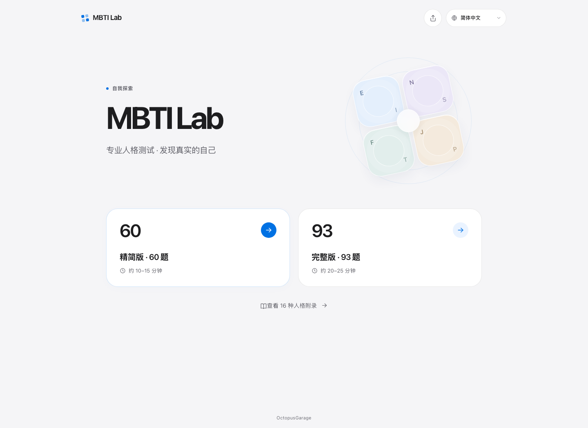
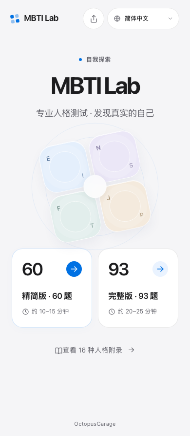
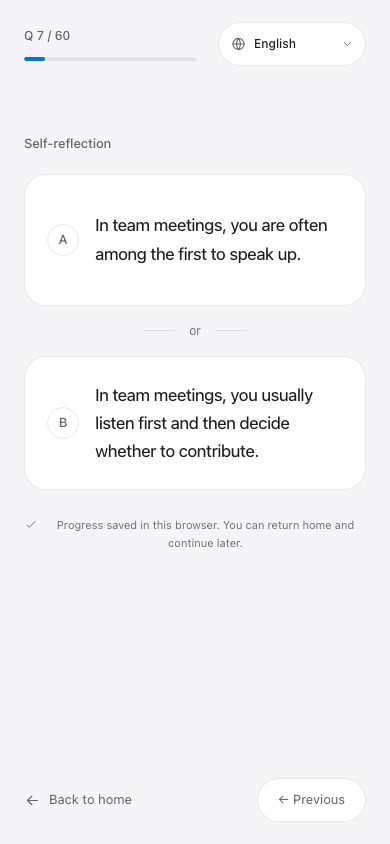
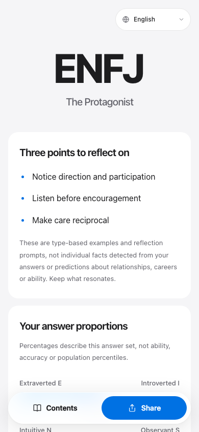
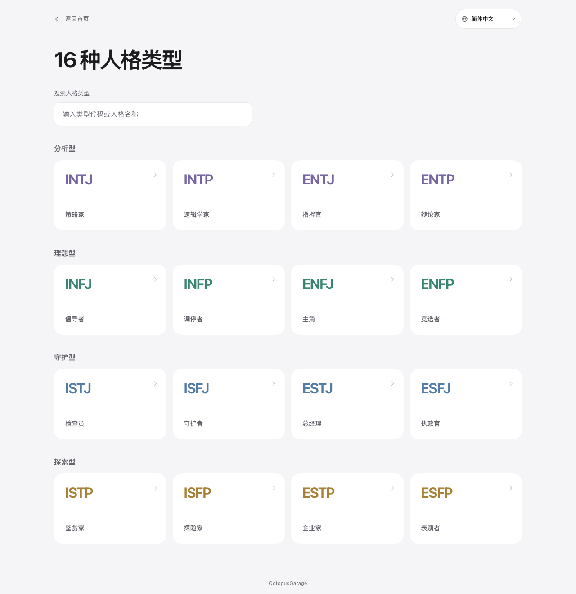

# Interface design

The interface uses an Apple-inspired light palette, clear hierarchy and quiet motion. MBTI Lab remains a browser-based reflection tool; its signature visual is a four-part lens representing the EI, NS, FT and JP choices, rather than a fabricated personality result.

## Foundation

`src/styles.css` owns the color, typography, radius, spacing and timing foundation. Canvas is mist white (`#f5f5f7`), reading surfaces are white, text is graphite (`#1d1d1f`), and the main action color is system blue (`#0071e3`). Family colors identify library groups with restraint. System display/body stacks support all eight languages without external font requests; numerical controls use tabular figures.

The home page introduces the product through an editorial hero and dimension lens. Separate 60- and 93-question choices communicate scope; drafts and genuine history remain visible when available. The assessment uses a focused central stage, clear progress and immediate selection feedback. Reports use generous reading widths, white surfaces, native disclosure rows, and a compact floating action dock. Library search and adjacent-type comparisons remain linked to browser history.

Sharing uses a centered desktop dialog and a mobile bottom sheet, consistent line icons, high-contrast primary copy action, and selectable clipboard fallback. The exported square card uses a quiet graphite palette with type accents and a readable QR code.

## Interaction and accessibility

Press feedback uses short transform/color transitions. CSS-only route entry motion keys on the path, preserving question state during query-only language changes and mounting new pages immediately without waiting for an animation frame. Modals keep the existing immediate Escape/backdrop behavior and focus restoration. Answers still advance after the existing feedback period; animations never drive scoring, persistence, navigation or completion.

Controls provide at least 44 px targets, visible keyboard focus and clear disabled states. Layouts fit 320 px and long translations. Reduced-motion preferences disable transitions and animations; transparent surfaces have opaque fallbacks. No infinite motion, scroll-jacking, external animation framework, or remote typography is required.

## References

These projects informed the visual review and implementation principles; their code and packages are not runtime dependencies:

- [Impeccable](https://github.com/pbakaus/impeccable): hierarchy, deliberate restraint and visual iteration.
- [Taste Skill](https://github.com/Leonxlnx/taste-skill): subject-specific visual direction and avoiding generic templates.
- [Emil Kowalski design engineering](https://github.com/emilkowalski/skills/blob/main/skills/emil-design-eng/SKILL.md): purposeful motion, precise easing and responsive press feedback.
- [ibelick/ui-skills](https://github.com/ibelick/ui-skills): accessible design engineering.
- [gstack](https://github.com/garrytan/gstack): browser-based design review and verification.
- [UI/UX Pro Max](https://github.com/nextlevelbuilder/ui-ux-pro-max-skill): coherent design-system decisions.
- [Apple Human Interface Guidelines](https://developer.apple.com/design/human-interface-guidelines): clarity, hierarchy and platform-appropriate interaction.

## Verification

Run the full unit and production browser suites, both recorded content-evaluation gates, and inspect real screenshots at desktop and mobile sizes. Browser checks cover every localized report, full mobile assessments in the six added languages, dialog focus/privacy, all 128 PNG exports with QR decoding, and reduced-motion behavior. Authored report/question text and scoring remain outside this visual change.

## Local previews

These images show a local production build, separately from the README's deployed-site snapshots. The report and export come from a scripted all-A assessment, not a personal result. [Capture provenance](images/design/capture.json) records the build entry, browser and capture time.

| Mobile home | Assessment | Report | Sharing |
| --- | --- | --- | --- |
|  |  |  |  |

[Generated PNG card](images/design/share-card.png)

To refresh, run `npm run build`, start `npm run preview -- --host 127.0.0.1 --port 4199 --strictPort`, then run `npm run docs:design` in another terminal. Set `MBTI_PREVIEW_URL` to capture another preview URL. The script completes an actual 60-question demonstration, exports the real PNG, and leaves application text and styles untouched.
